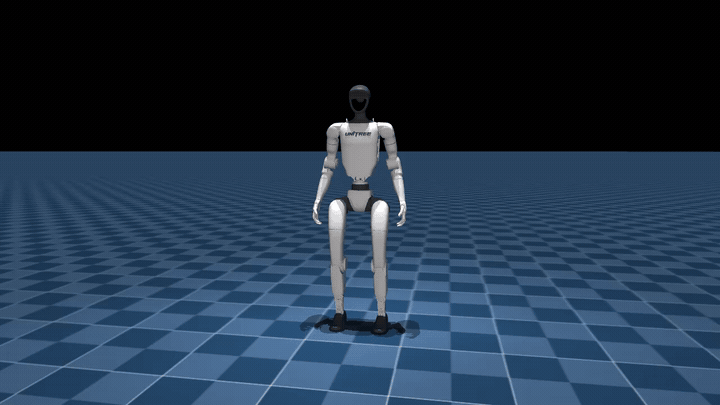
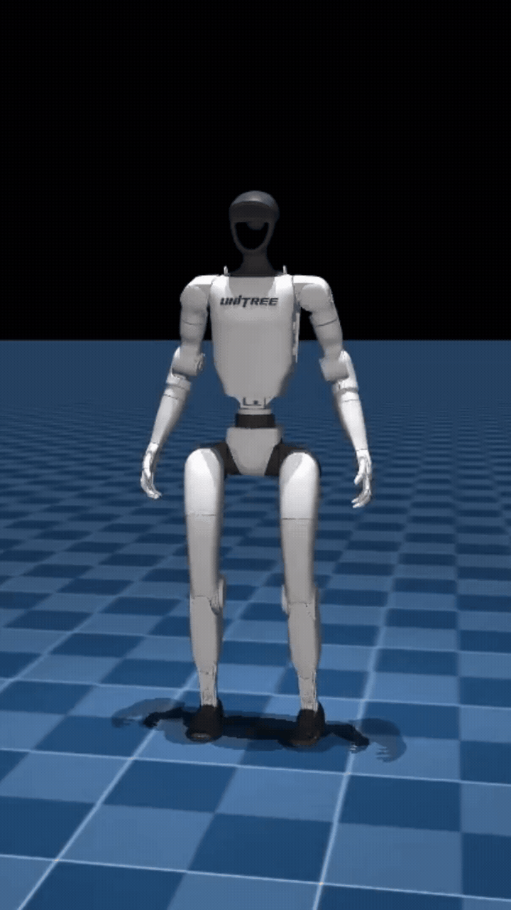
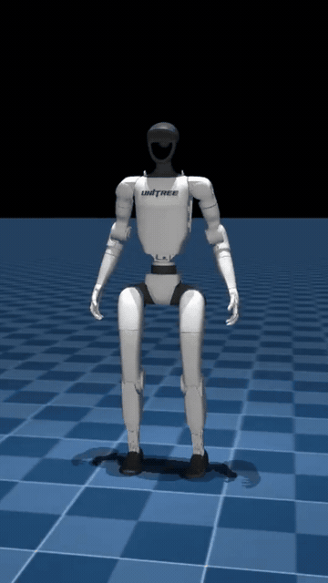

# Unitree G1 Humanoid: Multi-Motion Imitation with Reinforcement Learning

[-blueviolet.svg)](https://github.com/google-deepmind/mujoco)
[-success.svg)](https://www.unitree.com/g1/)
[-brightgreen.svg)](https://github.com/leggedrobotics/rsl_rl)

A deep reinforcement learning framework for the **Unitree G1 Humanoid (23-DOF)** to learn and execute multiple highly dynamic motions such as crouches and football kicks under a **single unified neural network policy**.


---

## Demonstrations

<p align="center">
  
</p>

<table align="center" width="100%">
  <tr>
    <td align="center" width="50%">
      <b>Motion 1: Spiderman Pose </b><br/>
      
    </td>
    <td align="center" width="50%">
      <b>Motion 2: Football Kick</b><br/>
      
    </td>
  </tr>
</table>

---

## Key Technical Innovations & Highlights

### 1. Unified Multi-Motion Policy Architecture
Instead of training individual policies per motion, a single policy is trained for command conditioned motion
- **`Command 0`**: Dynamic standing balance.
- **`Command 1`**: Spiderman pose.
- **`Command 2`**: Football kick.
- **Automatic Recovery**: Transition back to standing balance upon motion completion.
(This is trained example)

### 2. Joint Weighting
To ensure authentic motion imitation:
- **Joint DOF Weights**: Concentrated over $60\%$ of joint tracking rewards into the legs:
  - Knee joints: weight **$2.0$**.
  - Hip pitch joints: weight **$1.5$**.
  - Upper body / arms: weight **$0.8$**.
- **Targeted Cartesian 3D Tracking**: Explicitly tracking key endpoints:
  - Pelvis (`pelvis`), Knees (`left_knee_link`, `right_knee_link`), Feet (`left_ankle_roll_link`, `right_ankle_roll_link`), Torso (`torso_link`), and Wrists (`left_wrist_roll_rubber_hand`, `right_wrist_roll_rubber_hand`).


### 3. High-Dimensional Observation Space (865-D)
Actor and critic observation vectors are strictly formatted as `(865,)` containing:
- 5-step history of base linear/angular velocities, gravity projection, joint positions/velocities, previous actions, and motion phases.
- Current and relative reference joint positions and errors.
- 10-step future trajectory horizon prediction vectors.

---

## Repository Structure

```text
Mjlab/
├── configs/
│   ├── env_configs.py
│   ├── g1_config.py
│   └── rl_config.py
├── motion_file/
│   ├── spiderman.npz
│   ├── messi.npz
│   └── dance.npz
├── scripts/
│   ├── train.py
│   └── play.py
├── src/
│   ├── mdp/
│   │   ├── commands.py
│   │   ├── observations.py
│   │   └── rewards.py
│   ├── tasks/velocity/
│   │   └── velocity_env_cfg_free.py
│   └── utils/
│       └── motion_lib.py
├── videos/
│   ├── spiderman.gif
│   ├── kick.gif
│   └── g1_multi_motion_unified_policy.gif
├── environment.yml
└── logs/
```

---

## Quick Start & Usage

### 1. Environment Setup with `environment.yml`

Recreate the complete conda environment directly from [`environment.yml`](file:///home/yayy/My/Codeeeeee/RL_Robotics/G1_Humanoid/Mjlab/environment.yml):

```bash
# 1. Create the environment from environment.yml
conda env create -f environment.yml

# 2. Activate the environment
conda activate motion_mimic
```


### 2. Interactive Testing in Native MuJoCo Viewer

To test the trained multi-motion policy in the real-time interactive native viewer:

```bash
python -m scripts.play -e g1_multi_motion_v4 --motion_files motion_file/spiderman.npz motion_file/messi.npz --viewer native
```

> **Keyboard Controls :**
> - **`a`**: Trigger **Motion 1 (Spiderman Crouch)**
> - **`b`**: Trigger **Motion 2 (Messi Kick)**

### 3. Interactive Web Viewer (Viser)

To open a browser-based GUI with interactive trigger buttons and sliders:

```bash
python -m scripts.play -e g1_multi_motion_v4 --motion_files motion_file/spiderman.npz motion_file/messi.npz --viewer viser
```
Then navigate to `http://localhost:8080` in your browser.

### 4. Training from Scratch or Resuming

To start training a multi-motion imitation policy:

```bash
# Train from scratch across 4,096 parallel environments
python -m scripts.train -e g1_multi_motion_v4 --num_envs 4096 --motion_files motion_file/spiderman.npz motion_file/messi.npz
```

## License

This project is released under the MIT License. Based on the Unitree G1 humanoid model and Mjlab framework.
